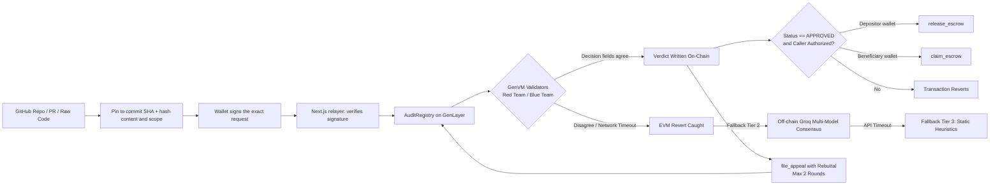

# ConsensusAudit

**A deployment gatekeeper: GenLayer validators independently audit contract code and reach consensus on APPROVED/REJECTED. A verdict reached on-chain can gate GEN escrow in the contract. If on-chain consensus fails, the app falls back to a clearly labeled off-chain check (Groq multi-model, then static heuristics) that never moves real funds.**

Track: **Onchain Justice** · Network: **GenLayer Studio Dev (Chain `61997`)**

Contract (redeploy `contracts/audit_registry.py` v9, then update `lib/contract-public.ts`): [`0x2Aa8038ea96051fb4748E538E7665Fe4EB39ef24`](https://explorer-studio-dev.genlayer.com/address/0x2Aa8038ea96051fb4748E538E7665Fe4EB39ef24)

Live Demo: `https://consensusaudit.vercel.app/`

---

## ⚠️ Note on the Live Vercel Demo

The live version of this application is hosted on Vercel's free Hobby tier, which strictly caps serverless API execution time at 60 seconds. 

Because GenLayer's decentralized AI consensus requires multiple validator nodes to independently analyze the code and vote on a verdict, full on-chain repository audits typically take between 1 to 4 minutes to finalize. As a result, repository audits on the live URL will likely time out and trigger the off-chain fallback engine.

**To experience the full, unconstrained GenLayer on-chain consensus, please follow the Quickstart instructions below to run the project locally.**

---

## The Problem

Agent-to-agent commerce keeps hitting the same wall: money is owed for a deliverable, and the two parties can't agree whether the deliverable is acceptable.

For smart contracts, "acceptable" has a sharp, objective meaning: it is either exploitable or it isn't. But today, that call is made by one centralized auditor, or one single LLM endpoint, and the paying party has to trust whoever made it. A verdict you can't verify isn't a basis for releasing funds.

ConsensusAudit turns that call into a decentralized consensus, and makes that consensus the literal on-chain trigger that moves real value.

## How it Works



Every submission is **bound** to what was reviewed: the exact content (SHA-256), the 40-hex commit it came from, and a scope manifest (which files, which extensions, what was truncated). The contract recomputes the hashes itself when the runner provides `hashlib`, and an appeal is rejected unless it carries the same repo, commit, content and scope as the audit it disputes. Changed code needs a new audit.

A submission runs inside a non-deterministic GenVM block. The leader performs a red-team / blue-team analysis of the payload; every validator performs its own independently and votes. They must absolutely agree on the **decision fields** (status, and whether any critical or high finding exists) before the verdict is written to state.

The verdict lands in contract storage under an immutable ID. The contract rejects any verdict whose reported critical/high counts do not equal the severities in its findings, and any non-integer or negative count. Escrow release is gated entirely by the contract, not the UI: `release_escrow` and `claim_escrow` transfer real `GEN` but will instantly revert unless the stored verdict reads `APPROVED` **and** the caller is the recorded depositor or beneficiary. Those calls are signed by the user's own wallet, so the roles are real wallet identities.

## Why this needs GenLayer

This architecture relies on three properties that a normal blockchain or a normal API simply cannot provide:

1. **The judgment is the consensus.** Validators independently reach the verdict. There is no oracle to trust, and no single LLM whose answer you take on faith.
2. **The judgment and the settlement live in the same contract.** The verdict isn't posted to a chain after the fact. The same non-deterministic execution that produced the audit is what the escrow gate reads.
3. **Subjective input, deterministic gate.** "Is this reentrant?" needs a language model. "Does a critical finding block release?" must not. The contract splits them: the LLM proposes counts and findings, and our python `_normalize()` function strictly decides the final status.

## Engineering & Design Highlights

**The 3-Tier Fault-Tolerant Architecture**

Decentralized testnets can occasionally struggle to reach exact JSON-matching consensus on complex LLM outputs. ConsensusAudit degrades in clearly labelled tiers. Only tier 1 is a GenLayer verdict:

1. **GenLayer Consensus:** Primary on-chain execution.
2. **Groq Multi-Model Consensus:** If the EVM reverts, the server catches it and routes the payload to multiple parallel LLMs (e.g., `gpt-oss-120b`, `gpt-oss-20b`). This is an off-chain model analysis, attested by the server's HMAC. It is never shown as GenLayer consensus and cannot hold or move funds.
3. **Static Heuristics:** If APIs fail, a fallback engine scans for known regex patterns (Reentrancy, `tx.origin`, unsafe `delegatecall`).

**JSON Serialization Storage Bypass**

To support dynamic mapping structures while adhering to GenVM's strict primitive storage compiler, the entire contract state (`verdicts`, `escrows`, `submission_ids`) dynamically serializes and deserializes from `str`. This avoids compiler errors with dynamic mappings; the trade-off is that each write rewrites the whole blob.

**Native Custody & Beneficiary Claims**

`open_escrow` is a `@gl.public.write.payable` method that locks real `GEN` directly from `gl.message.value`. The beneficiary can call `claim_escrow` from their own wallet once the verdict is `APPROVED`, closing the "depositor refuses to release" case. Payout transactions (release, claim, refund) have not yet been confirmed end to end on Studio Dev; test with a small amount first.

**Intelligent Repository Ingestion**

The orchestrator resolves a repo, PR or file to an immutable commit SHA, then fetches by that SHA (never by branch name). For repositories it scores files (prioritizing `.sol` / `core` / `contract` over `test` / `mock`) and reviews the top 3, each capped at 5,000 characters. Truncation is recorded in the scope manifest and shown in the certificate, so a partial review is never presented as a full one.

**Validator Telemetry & Certificate Export**

The UI features live node simulation states and allows users to export a finalized Markdown security certificate containing the execution latency, vulnerability counts, the reviewed content hash, commit and scope, and the transaction link.

## What's on Chain

| State | Meaning |
| --- | --- |
| `verdicts[submission_id]` | status, critical/high counts, findings, submitter, repo URL, commit SHA, content hash, scope manifest/hash, appeal depth, previous id |
| `escrows[submission_id]` | status, amount, depositor, beneficiary |

**Audit Methods:** `submit_audit`, `file_appeal`, `get_verdict`, `list_submissions`  
A caller always acts as itself. Only the owner-approved relayer (`set_relayer`) may record a different `submitter`, and the server only does so after verifying that wallet's signature over the content hash, commit, scope and nonce.

**Escrow Methods:** `open_escrow` *(payable)*, `release_escrow`, `claim_escrow`, `refund_escrow`, `get_escrow`

**Admin Methods:** `set_paused`, `transfer_ownership`, `set_relayer`, `admin_force_refund`, `get_relayer`, `get_contract_balance`, `get_version`, `get_owner`

## Quickstart

```bash
git clone https://github.com/uchecharles/ConsensusAudit-Agent
cd ConsensusAudit-Agent
npm install
cp .env.example .env.local   # then fill in the values below
npm run dev

```

### Environment Variables

| Variable | Required | Purpose |
| --- | --- | --- |
| `GENLAYER_PRIVATE_KEY` | for on-chain audits | Relayer key. Pays for audits whose request a user wallet signed, and posts PR statuses. Must hold testnet `GEN` and be registered by the owner with `set_relayer`. It cannot do escrow or admin actions. |
| `ATTESTATION_SECRET` | yes | HMAC key for off-chain verdict attestations. |
| `GROQ_API_KEY` | yes | Powers the off-chain multi-model analysis. |
| `GITHUB_TOKEN` | no | Raises the GitHub API rate limit and reads repos you own. |
| `GITHUB_WEBHOOK_SECRET`, `GITHUB_BOT_TOKEN` | for the PR gate | The webhook rejects requests without a valid `X-Hub-Signature-256`. Statuses are only posted from a verified on-chain verdict. |

## Reproducing the Demo

1. Click **Connect wallet** (MetaMask on GenLayer Studio Dev; the app adds the network). Without a wallet, audits run off chain only and are labelled as such.
2. Choose **Raw code** (pre-filled with `VulnerableVault`) and click **Run audit**. Your wallet shows the exact request to sign. You should see REJECTED with a Critical reentrancy finding and a tx link. Model output can vary.
3. Look up the submission ID with `get_verdict` in the explorer to confirm the stored verdict.
4. Submit an appeal with a rebuttal. A second record is created with `is_appeal=true` and `previous_id` set.
5. Escrow (open/release/claim/refund) and admin actions are signed by the connected wallet. Use two wallets to demo depositor and beneficiary separately.

## GitHub PR gate

`/api/webhook` pins the PR head commit, submits it to the contract with `submit_audit`, and sets the commit status from the finalized on-chain verdict for that exact commit. If the chain is unreachable or the verdict cannot be verified, the status is `error` ("Not audited"), never a pass. `/api/audit/status` re-verifies any transaction hash against the contract before calling it a consensus result.

## Layout

```text
contracts/audit_registry.py  intelligent contract: adjudication, verdicts, payable escrow, admin
lib/verdict.ts               universal normalizer: enforces the "criticals mean REJECTED" invariant
lib/genlayer.ts               server-only relayer + read clients, id generation
lib/binding.ts                content / commit / scope hashing and the scope manifest
lib/github-pin.ts             GitHub ingestion pinned to commit SHAs; exact re-fetch for appeals
lib/audit-auth.ts             wallet-signed (EIP-191) audit request messages and verification
lib/onchain-audit.ts          relay + post-hoc verification of the finalized transaction
lib/wallet.ts                 browser wallet: signs escrow and admin transactions
lib/contract-public.ts        safe shared constants (address, explorer URLs) for client and server
app/api/audit/prepare/route.ts pins content to a commit and returns the exact text to sign
app/api/audit/route.ts        verifies the signature, relays on chain, else off-chain analysis (labelled)
app/api/audit/status/route.ts verifies a tx hash against the contract before reporting consensus
app/api/webhook/route.ts      signed GitHub webhook -> contract verdict -> commit status
app/api/admin/route.ts        read-only chain telemetry (writes are wallet-signed in the browser)
app/api/lookup/route.ts       direct read access for querying verdicts, escrows, and submission lists
app/page.tsx                  interactive dashboard: audit, appeal, settlement, lookup, and admin UI

```
